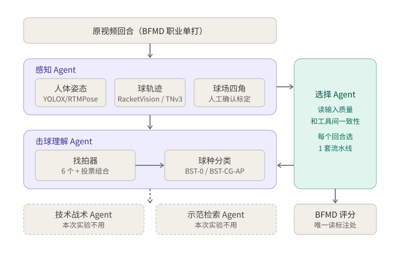

# goodminton

羽毛球单打录像分析研究原型：从原视频识别球员姿态和球轨迹，找出每一次击球，判断球种，并由 Agent 为每个回合选择最合适的技术流水线。

## 架构

系统分为四个有状态的 Agent，由控制器按注册的工具和预算调度（不是多个大模型自由对话）：

| Agent | 职责 | 代码 |
|---|---|---|
| 感知 Agent | 人体姿态（YOLOX/RTMPose）、球轨迹（RacketVision、TrackNetV3）、球场几何 | `professional_agents/agents.py`、`racketvision_adapter.py`、`specialist_tracknet.py` |
| 击球理解 Agent | 找拍（几何规则、声画融合、GRU、ShuttleHitFormer、Adapted-HitNet、RGB ResNet）+ BST 球种分类 | `professional_agents/hit_tools.py`、`hit_worker.py`、`specialist_bst.py` |
| 技术战术 Agent | 结构化观测、证据目录、可选本地 Qwen | `research_quality.py`、`tactical_review.py` |
| 示范检索 Agent | 职业片段检索 | `professional_agents/retrieval.py` |

选择 Agent 只读取不含标注的信息（双人姿态覆盖、球可见率、有效窗口比例、各找拍器之间的一致性），为每个回合从约 30 套 感知 × 找拍 × 分类 组合中选一套。

## 目录结构

| 位置 | 内容 |
|---|---|
| 根目录 `*.py` | 核心模块：网站与任务（`server.py`、`*_jobs.py`）、感知、找拍、BST 分类、标注与个人学习、研究集成 |
| `professional_agents/` | 四 Agent、工具注册、控制器、工作流搜索 |
| `paper_reproductions/` | ShuttleHitFormer、DSTA 本地复现与配置 |
| `benchmarks/` | BFMD 导入、评分、流水线选择实验、数据隔离 |
| `research_models/` | 模型登记、架构与融合设置 |
| `static/` | 网页前端 |
| `scripts/audit/` | 历史输入/时间/身份问题审计 |
| `scripts/diagnose/` | 故障诊断与一致性校验 |
| `scripts/evaluate/` | 离线评价与基准 |
| `scripts/reproduce/` | 原作者流程复现与权重转换 |
| `scripts/data_prep/` | 数据导入与预处理 |
| `scripts/reports/` | 报告与证据图生成 |
| `tests/` | 单元与集成测试 |

`scripts/` 和 `tests/` 中的文件会自动把原型根目录加入 `sys.path`，可以从任意目录运行。

## BFMD 流水线选择实验

`benchmarks/bfmd/` 中的脚本在 BFMD 职业单打上比较各流水线和选择策略：

| 脚本 | 作用 |
|---|---|
| `rally_clips.py` | 按比赛拆分（开发 8 场 / 封存测试 4 场），固定种子分层抽取回合并切片 |
| `study_perception.py` | 对每个回合运行姿态和两种球轨迹模型 |
| `study_hits.py` | 运行每个找拍器，再用 BST-0 / BST-CG-AP 分类 |
| `study_select.py` | 投票组合与选择策略（固定最优、规则路由、一致性、学习路由、事后最优），留一场比赛交叉验证 |
| `study_score.py` | 唯一读取 BFMD 标注的评分步骤；策略冻结前拒绝评测试集 |

## 本仓库不包含

- 模型权重（`models/`）和第三方代码（`vendor/`）：请按各上游仓库的许可证自行获取。
- 视频、标注和实验数据：个人录像不公开；BFMD 视频请按 [BFMD](https://github.com/Ning-D/BFMD) 说明自行下载。
- Python 环境：依赖见 `requirements-*.lock.txt`。

部分配置和代码中的路径仍是原开发机的绝对路径，迁移时需要调整。
