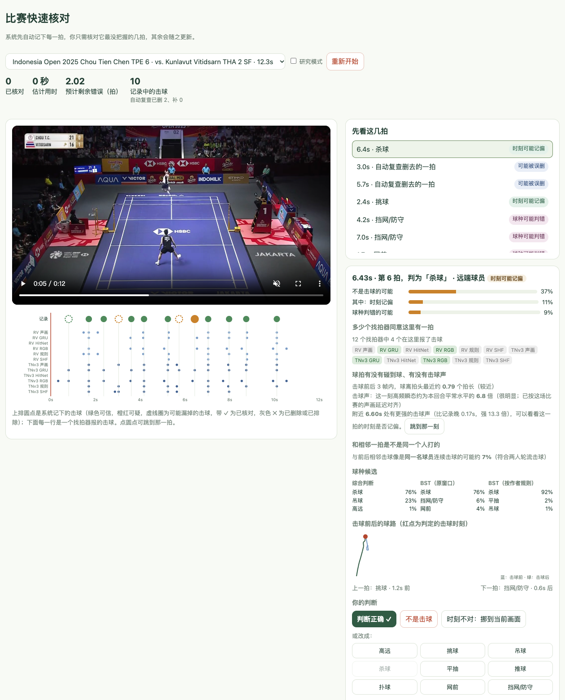
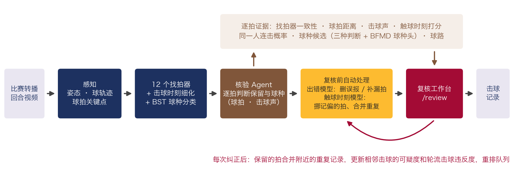
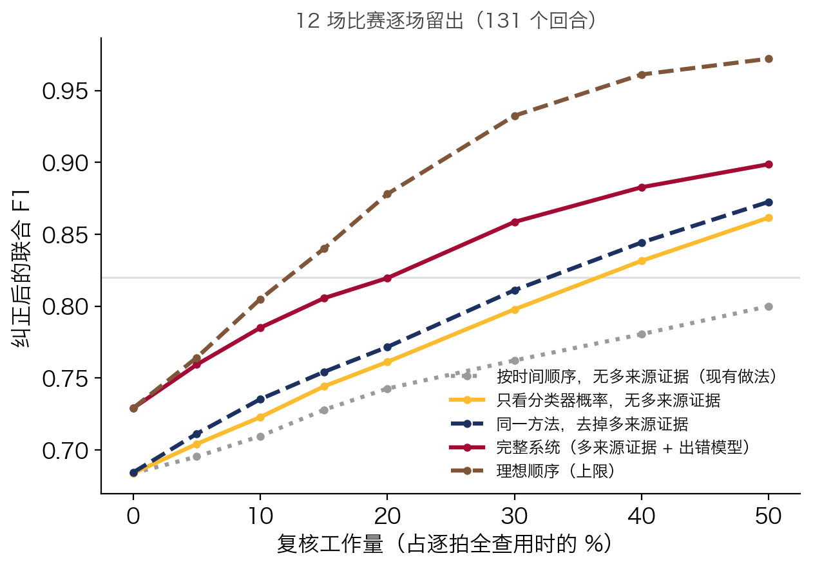
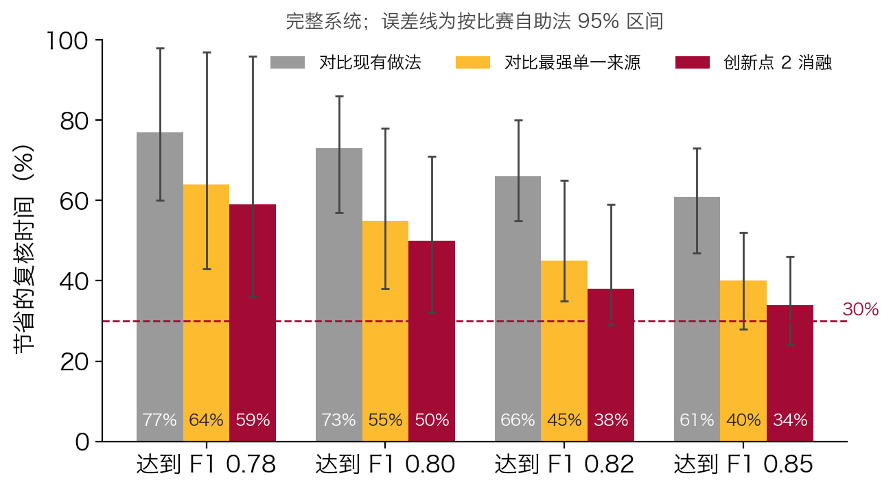
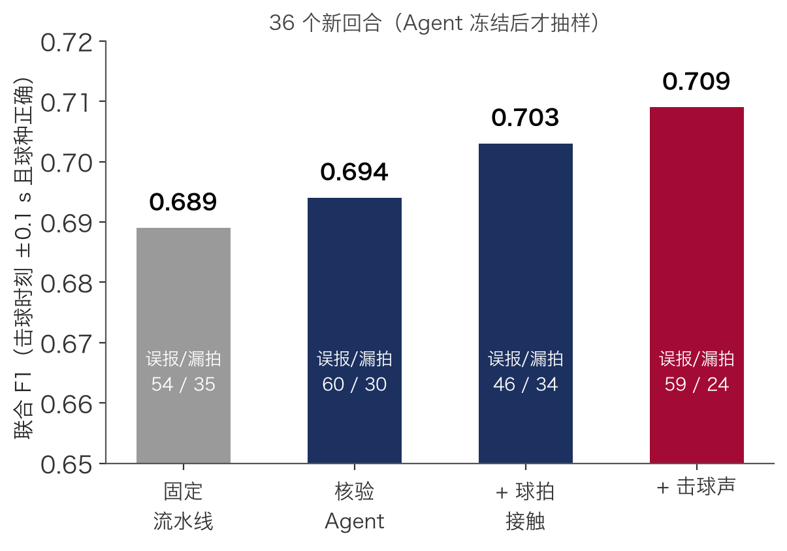
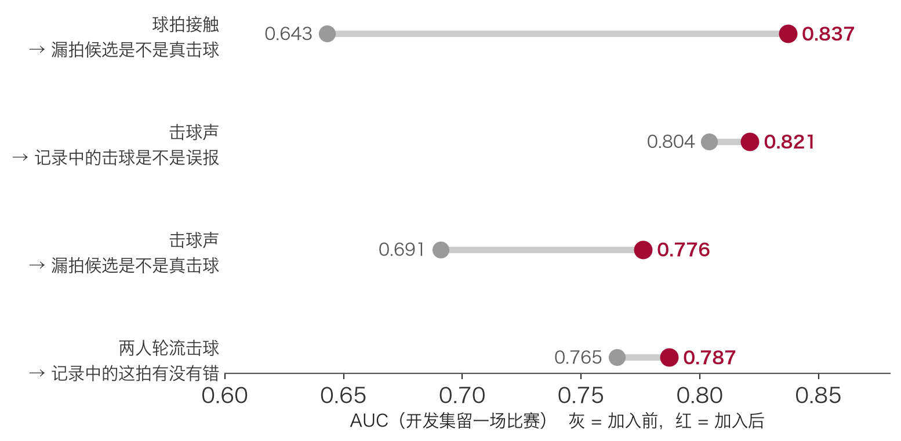
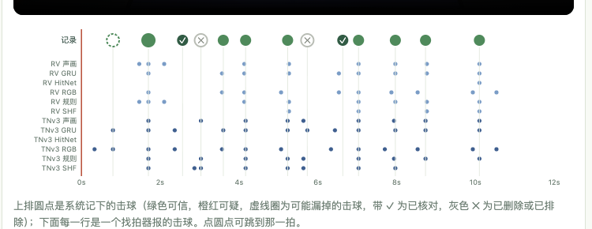
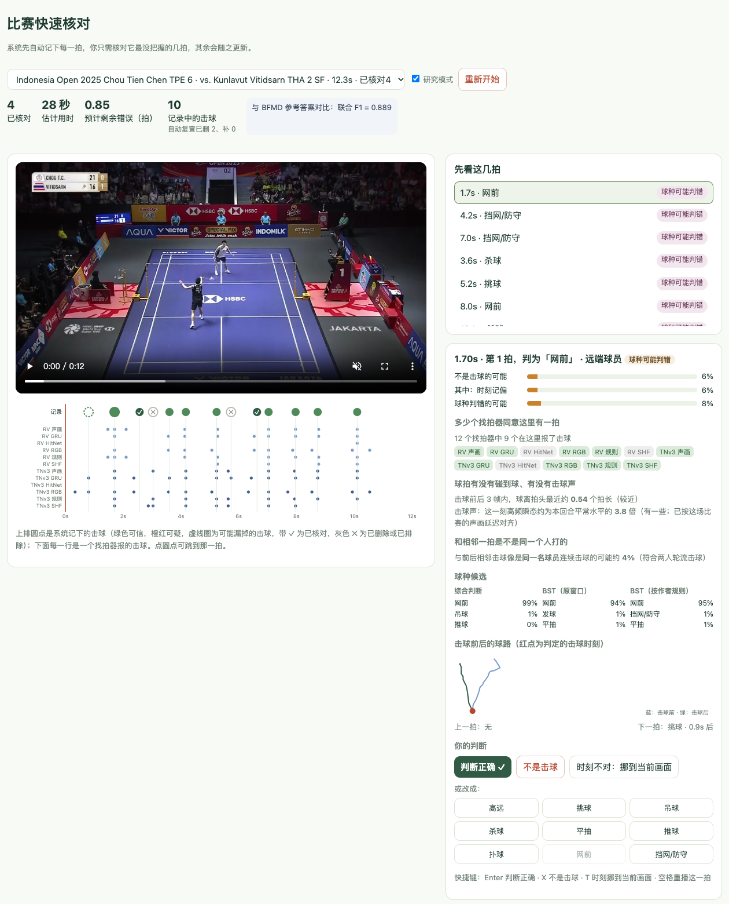

# goodminton

羽毛球单打比赛录像的**击球记录与快速复核**研究原型。

系统先从比赛转播视频自动记下每一拍（击球时刻 + 球种），再把最可能出错的几拍按“改了收益最大”的顺序交给运动员或分析员核对，并在每一拍旁边给出判断用的证据：找拍器是否一致、球拍是否碰到球、有没有击球声、时刻是否记偏。

在 12 场 BFMD 职业单打上逐场留出评测：要把记录纠正到联合 F1 0.80，所需复核时间比现有的逐拍顺序核对少 **73%**，比只看分类器概率的排序少 **55%**；只去掉多来源证据、其余不变，时间要多花一倍（节省 50%）。



## 目录

- [研究问题与技术点](#研究问题与技术点)
- [系统架构](#系统架构)
- [目前结果](#目前结果)
- [复核工作台：交互逻辑](#复核工作台交互逻辑)
- [运行](#运行)
- [代码结构](#代码结构)
- [本仓库不包含](#本仓库不包含)

## 研究问题与技术点

在原始转播视频上，现有找拍器和球种分类器（TrackNetV3、RacketVision、GRU、ShuttleHitFormer、BST 等）组合起来，联合 F1（击球时刻 ±0.1 s 且球种正确）也只有约 0.7。也就是说，每 10 拍里大约有 3 拍是错的、漏的或球种不对。全部人工重看代价太高，所以这里研究的是：**在有限的复核时间内，怎样让人只看最该看的那几拍，并且一眼看出它为什么可疑。**

1. **问题与基准**：在 BFMD 职业单打 12 场上复现 12 条“球轨迹 × 找拍器”路线和两种 BST 球种分类，量化自动记录的错误构成（误报、漏拍、球种错，以及占漏拍约三分之二的“时刻记偏”），并以“达到同一准确率需要多少复核时间”作为评价指标，按比赛逐场留出。
2. **多来源证据与出错模型（主要技术贡献）**：每一拍汇集互相独立的证据，用来自动核验、估计每种错误的概率并排序，也直接展示给复核者：
   - 12 个找拍器里有几个在这里报了击球，以及它们各自给出的球种是否一致；
   - 球拍接触：击球前后 3 帧内球离拍头的最近距离（RacketVision 球拍关键点，以拍长为单位）；
   - 击球声：10–20 kHz 高频瞬态强度，按每场比赛无标注估计的声画延迟（0.06–0.24 s）对齐；附近更强的击球声提示时刻可能记偏；
   - 三种球种判断的候选（综合判断、BST 原窗口、BST 作者切片规则）、击球前后的球路、两人轮流击球是否被违反；
   - BFMD 专用球种判断：取 BST 分类头前的 600 维特征，在没见过该场比赛的 BFMD 标注上训练的球种头，看它是否同意当前球种。

   出错模型按错误类型（误报、时刻记偏、球种错、漏拍）分别拟合；训练比赛的输入由没见过该场的核验 Agent 交叉拟合产生。交给复核者之前，出错模型先做第二遍自动核验（删去很可能是误报的拍、补上很可能真实的漏拍，被动过的拍沿用这一遍的概率，复核时可以改回）。完整系统达到 F1 0.78 / 0.80 / 0.82 / 0.85 所需的复核时间，比去掉多来源证据、其余不变的同一方法少 59% / 50% / 38% / 34%（见下表）。
3. **回合结构**：轮流击球和击球节奏作为证据进入核验 Agent；工作台在每次纠正后重新解码回合、更新相邻击球的可疑度。但在 12 场逐场留出中，“纠正后传播”相对不传播没有可测的增益（±0.3 个点），因此不作为单独的技术贡献主张。

## 系统架构



| 阶段 | 做什么 | 代码 |
|---|---|---|
| 感知 | 人体姿态（YOLOX / RTMPose）、球轨迹（RacketVision `rv`、TrackNetV3 `tn3`）、球拍关键点 | `benchmarks/bfmd/study_perception.py`、`racketvision_adapter.py`、`specialist_tracknet.py` |
| 找拍 | 6 种找拍器（几何规则、声画融合、GRU、ShuttleHitFormer、Adapted-HitNet、RGB ResNet）× 2 种球轨迹 = 12 条路线，再做击球时刻细化 | `benchmarks/bfmd/study_hits.py`、`refine.py`、`professional_agents/hit_tools.py` |
| 球种 | BST-0 / BST-CG-AP，映射到 BFMD 9 类（高远、挑球、吊球、杀球、平抽、推球、扑球、网前、挡网/防守；发球不计分） | `specialist_bst.py`、`benchmarks/bfmd/bfmd_labels.py` |
| 核验 Agent | 把 12 条路线的候选合并，逐拍判断“保不保留”和“是什么球种”。特征包括找拍器一致性、球路转向与速度、BST 置信度、姿态、球拍接触、击球声 | `benchmarks/bfmd/verify.py`、`audio.py` |
| 复核 | 排序队列、证据面板、纠正后的回合重解码与传播；离线模拟评测 | `benchmarks/bfmd/review.py`、`review_web.py`、`static/review.html` |

评测时，每场比赛的回合只由在另外 11 场上拟合的核验 Agent 和出错模型处理；复核工作台使用同样冻结的逐场模型包 `frozen_review_lomo12.json`。

## 目前结果

数据：BFMD 职业单打 12 场、131 个回合（约 1300 次非发球击球）。主结果为 **12 场比赛逐场留出**：每场比赛只由在另外 11 场上拟合的模型处理，置信区间按比赛自助抽样 1000 次。

### 复核效率

用 BFMD 参考答案模拟一个复核者：每看一项就按真值修正（删误报、改球种、把记偏的击球挪到正确时刻、补漏拍）。复核成本为假设值：核对一拍 5 秒、挪动时刻另加 3 秒、核对一个漏拍候选 6 秒（需在用户实验中实测）。横轴是“复核用时占逐拍全查用时的比例”。



| 联合 F1 / 复核比例 | 0 | 10% | 20% | 30% | 50% |
|---|---:|---:|---:|---:|---:|
| 现有做法：无多来源证据，按时间顺序逐拍核对 | 0.684 | 0.710 | 0.743 | 0.762 | 0.800 |
| 最强单一来源基线：无多来源证据，按分类器概率排序 | 0.684 | 0.723 | 0.761 | 0.798 | 0.862 |
| 同一方法去掉多来源证据（出错模型 + 第二遍自动核验） | 0.684 | 0.735 | 0.772 | 0.811 | 0.873 |
| 完整系统：按核验 Agent 置信度排序 | 0.721 | 0.759 | 0.799 | 0.833 | 0.887 |
| 完整系统：出错模型排序（上一版） | 0.721 | 0.770 | 0.812 | 0.844 | 0.896 |
| **完整系统：+ BFMD 球种头证据 + 第二遍自动核验** | **0.729** | **0.785** | **0.820** | **0.859** | **0.899** |
| 理想顺序（上限，同一起点） | 0.729 | 0.805 | 0.878 | 0.932 | 0.972 |

达到同一联合 F1 所需复核时间，完整系统节省：



| 完整系统对比 | 达到 F1 0.78 | 0.80 | 0.82 | 0.85 |
|---|---:|---:|---:|---:|
| 现有做法（无多来源证据，逐拍顺序核对） | 77% [60, 98] | 73% [57, 86] | 66% [55, 80] | 61% [47, 73] |
| 最强单一来源基线（无多来源证据，按分类器概率） | 64% [43, 97] | 55% [38, 78] | 45% [35, 65] | 40% [28, 52] |
| 同一方法去掉多来源证据（创新点 2 消融） | 59% [36, 96] | 50% [32, 71] | 38% [29, 59] | 34% [24, 46] |
| 上一版完整系统（无球种头、无第二遍自动核验） | 26% [2, 55] | 19% [4, 33] | 10% [3, 24] | 14% [1, 19] |

方括号为 95% 区间。节省来自三部分：多来源证据让自动记录本身更准（复核前 0.684 → 0.721），第二遍自动核验再提到 0.729，出错模型让前 30% 的复核更集中在真错误上。没有多来源证据时，第二遍自动核验什么也不改（0.684 → 0.684）。

“挪动时刻”这个操作单独看：在 50% 以内的复核量上只省 1–5% 的时间（区间包含 0），时刻证据用于排序也没有增益；它的作用在复核后期，全部复核完时剩余漏拍从 103 个减到 76 个（联合 F1 0.950 → 0.962）。

### 自动记录与证据



单独抽取的 36 个新回合上（Agent 冻结后才抽样），复核前联合 F1：固定流水线 0.689 → 核验 Agent 0.694 → + 球拍接触 0.703 → + 击球声 0.709。



在 12 场留出中，专门的出错模型对各类错误的区分度（AUC，只用置信度 → 用全部证据，未含球种头）：误报 0.829 → 0.886，时刻记偏 0.801 → 0.811，球种错 0.838 → 0.842，漏拍候选 0.775 → 0.790。

### 试过但没有用的方法

- 纠正后传播（相邻击球的可疑度、重解码回合、重算轮流击球）：12 场留出中相对不传播 ±0.3 个点。
- 按回合规律传播球种（学到的球种转换先验）：相邻标签变对和变错大约各半。
- 按错误类型校准、按场在线调整出错概率：都不如未校准的收益排序。
- 同场比赛用已核对击球微调分类器或相似击球投票：剩余击球的球种准确率没有实质提升。
- 自动把击球时刻对齐到击球声 / 球拍峰值：改对和改错相当；只作为给复核者的提示。
- 把 BFMD 球种头直接加进球种模型：复核前 F1 反而 0.721 → 0.717；只作为出错证据时才有用。
- 让复核者只报每回合总拍数再重选击球、在“同一人连击”的空档里找漏拍：几乎没有作用。
- 加训练数据（3 → 11 场）：复核前 F1 提高，但出错信号的区分度不再提高。
- 用确认的击球重估声画延迟、每场比赛的击球声纹、只靠声音补出漏拍：都不如直接用击球声强度，或误报太多。

## 复核工作台：交互逻辑

地址：`http://127.0.0.1:8765/review`。页面分成四块：顶部状态、左侧视频与证据时间轴、右上“先看这几拍”队列、右下当前这拍的证据和操作。

### 1. 选回合

右上角下拉框按比赛列出全部 131 个回合，显示赛事、对阵、时长和已核对数。每个回合都由没见过这场比赛的冻结模型处理，所以研究模式下的对比是公平的。也可以直接用链接打开：`/review?clip=<回合 ID>`。打开后自动选中队列第一项，视频跳到这一拍前 1.2 秒播放到后 0.8 秒，画面先显示击球那一帧。

### 2. 顶部状态

| 数字 | 含义 |
|---|---|
| 已核对 | 本回合已做的操作数 |
| 估计用时 | 按每拍 5 秒、每个漏拍候选 6 秒、挪动时刻另加 3 秒估算 |
| 预计剩余错误（拍） | 未核对击球的 P(误报) + P(球种错) 与未核对漏拍候选的 P(确实漏了) 之和 |
| 记录中的击球 | 当前记录里的击球数；下方小字为第二遍自动核验删去 / 补上的拍数 |
| 研究模式（勾选后显示） | 与 BFMD 参考答案对比的联合 F1，只用于研究演示，正常复核时不显示 |

### 3. 证据时间轴（视频下方）



- 最上一排是系统记下的击球：绿色 = 可信，橙 / 红 = 可疑（颜色按出错概率），虚线圈 = 可能漏掉的击球，深绿带 ✓ = 已核对保留，灰色 ✕ = 已删除或已排除。选中的那一拍画得更大。
- 下面 12 行是 12 条找拍路线各自报的击球时刻（RV / TNv3 × 声画、GRU、HitNet、RGB、规则、SHF）。很多行在某处都有点而上排没有，就是可能漏拍；上排有点而下面几乎没有，就是可能误报。
- 红色竖线跟着视频播放位置移动。点上排任意圆点即可跳到那一拍。

### 4. “先看这几拍”队列

按“改了它对联合 F1 的预期收益 ÷ 核对它要花的秒数”排序：

- 各类错误的概率来自出错模型：它读取这一拍的全部证据（找拍器一致性、球拍、击球声、时刻证据、球种候选是否一致、轮流击球、节奏），按错误类型分别给出 P(误报)、P(时刻记偏)、P(球种错 | 是击球)、P(漏拍是真的)；
- 预期收益 = P(时刻记偏) × 2 + [P(误报) − P(时刻记偏)] × 0.7 + [1 − P(误报)] × P(球种错) × 2，漏拍候选为 P(漏拍是真的) × 1.3（由 F1 公式推得的近似权重）；秒数为 5（漏拍候选 6），可能需要挪时刻的按概率另加 3；
- 出错几率还会乘上邻居纠正带来的可疑度（邻居错过 ×约 1.6，邻居对 ×约 0.9）。

每项旁边的标签是预期收益最大的那类错误：“时刻可能记偏”、“可能不是击球”、“球种可能判错”、“可能漏了一拍”，或“可能被误删”（第二遍自动核验删掉、但仍有一定可能是真击球的拍，时间轴上显示为虚线圈）。

### 5. 证据面板（当前这拍）

从上到下：

1. **标题**：时刻、第几拍、当前判定的球种、近端还是远端球员、可疑原因。
2. **概率条**：记录中的击球显示“不是击球的可能”、其中“时刻记偏”的部分和“球种判错的可能”；漏拍候选显示“确实有一拍的可能”。
3. **多少个找拍器同意这里有一拍**：12 个标签，绿色表示该路线在 ±窗口内报了击球。
4. **球拍有没有碰到球、有没有击球声**：球离拍头最近多少个拍长（<0.5 很近，<1.5 较近，否则较远），以及这一刻高频瞬态是本回合平常水平的几倍（≥4 很明显，≥2 有一些）。如果前后 0.3 秒内有强 8 倍以上的击球声，会提示“附近有更强的击球声”，并给一个“跳到那一刻”按钮（这类提示约出现在 5% 的击球上，其中约四分之一确实记偏，所以只是让人去看，不会自动挪）。
5. **和相邻一拍是不是同一个人打的**：同一人连击的概率；≥60% 时提示附近很可能有误报或漏拍。
6. **球种候选**：综合判断、BST 原窗口、BST 按作者规则三列，各列前三名及概率。
7. **击球前后的球路**：蓝线为击球前，绿线为击球后，红点为判定的击球时刻；下方显示上一拍和下一拍的球种与时间差。

### 6. 操作和它们的效果

| 对象 | 操作 | 快捷键 | 效果 |
|---|---|---|---|
| 记录中的击球 | 判断正确 ✓ | Enter | 锁定这拍和它的球种 |
| 记录中的击球 | 不是击球 | X | 从记录中删除并锁定 |
| 记录中的击球 | 点某个球种按钮 | — | 改成该球种并锁定 |
| 记录中的击球 | 时刻不对：挪到当前画面 | T | 把这拍挪到视频当前时刻（先用空格重播、暂停在触球那一帧，或用“跳到那一刻”），之后仍可点球种按钮改球种 |
| 漏拍候选 | 点某个球种按钮（“确实漏了，球种是：”） | — | 加入记录并锁定 |
| 漏拍候选 | 没有漏拍 | X | 排除并锁定 |
| 任意 | 重播这一拍 | 空格 | 从击球前 1.2 秒播到后 0.8 秒 |

每次操作后服务器依次：

1. 先检查操作是否适用于这一项（不适用的不会被保存），再锁定；如果这次操作说明系统原来错了（删除、补拍、挪时刻、改成不同球种），把前后相邻击球的出错几率乘约 1.6，否则乘约 0.9；
2. 重新解码整个回合：已锁定的击球作为固定值，其余击球的球种按前后文和球种转换先验重算（删掉或补上一拍会改变相邻击球的上下文）；
3. 重算每一拍的轮流击球违反度、预计剩余错误和队列；
4. 自动跳到新的队列第一项并播放（挪动时刻后则停在这一拍，方便接着改球种）。

打开这个回合时，第二遍自动核验已经删去 2 拍（3.0 s、5.7 s，两拍都是误报），研究模式下的联合 F1 从 0.600 变成 0.667。下图是按队列前 4 项操作后的状态：把 2 个记偏的击球挪到正确时刻（6.43 → 6.63 s，证据面板已提示 6.60 s 处有更强的击球声；2.37 → 2.57 s），确认 2 个被自动删去的拍确实不是击球，估计 28 秒。预计剩余错误从 2.02 降到 0.85，联合 F1 从 0.667 升到 0.889；时间轴上出现 ✓ 和 ✕，队列转向“球种可能判错”的几拍。



### 7. 保存与重置

- 每个回合的核对记录保存为操作列表（`pipeline_study/review_sessions/<回合>.json`，含时间戳）。重新打开页面时按顺序重放这些操作，所以状态总是可复现的；服务重启后也能接着核对。
- “重新开始”清空该回合的操作记录。
- 修改记录的请求需要页面里的会话令牌，并且只接受本机访问。

## 运行

依赖见 `requirements-vision.lock.txt`（网站和复核）、`requirements-pose.lock.txt`（姿态）、`requirements-specialist.lock.txt`（找拍与 BST）。

```bash
cd 04_原型
.venv-vision/bin/python server.py          # http://127.0.0.1:8765，复核页面为 /review
```

复核页面需要 BFMD 研究数据已经跑好（`03_数据/独立基准/BFMD/pipeline_study/` 下的 `clips.json`、各回合的 `perception/`、`routes_v3/` 和逐场模型包 `frozen_review_lomo12.json`）。从头生成：

```bash
python benchmarks/bfmd/rally_clips.py --cut               # 按比赛拆分开发 / 测试，抽取回合并切片（--new-test 抽新回合）
python benchmarks/bfmd/study_perception.py --role dev     # 姿态、两种球轨迹、球拍关键点
BFMD_VARIANT=v3 python benchmarks/bfmd/study_hits.py --role dev --expensive   # 12 条找拍路线 + BST 球种（各角色都跑）
python -m benchmarks.bfmd.verify evaluate                 # 核验 Agent，开发集留一场比赛
python -m benchmarks.bfmd.verify freeze                   # 用全部开发集拟合并冻结
python -m benchmarks.bfmd.verify apply --role new_test    # 冻结 Agent 处理新回合
python benchmarks/bfmd/study_score.py --role new_test     # 唯一读取 BFMD 标注的评分步骤
REVIEW_TYPEHEAD=2 python -m benchmarks.bfmd.review lomo  # 12 场逐场留出：复核模拟，含 BFMD 球种头证据（REVIEW_ABLATE=sources 去掉多来源证据；REVIEW_RETIME=0 只能删除不能挪时刻）
python -m benchmarks.bfmd.review_metrics "auto pass + evidence" --run typehead2 --base-run ablate_sources   # 节省时间与自助法区间
REVIEW_TYPEHEAD=2 python -m benchmarks.bfmd.review freeze  # 冻结工作台用的逐场模型包（含球种头和第二遍自动核验阈值）
```

## 代码结构

| 位置 | 内容 |
|---|---|
| 根目录 `*.py` | 核心模块：网站与任务（`server.py`、`*_jobs.py`）、感知、找拍、BST 分类、标注与个人学习、研究集成 |
| `benchmarks/bfmd/` | BFMD 导入、回合切片、找拍与球种实验、核验 Agent、声音证据、复核模拟与复核工作台后端 |
| `static/` | 网页前端（`review.html` 为复核工作台） |
| `professional_agents/` | 早期的四 Agent 编排（感知、击球理解、技术战术、示范检索）和工具注册 |
| `paper_reproductions/` | ShuttleHitFormer、DSTA 本地复现与配置 |
| `research_models/` | 模型登记、架构与融合设置 |
| `scripts/` | 审计、诊断、评价、作者流程复现、数据准备、报告生成 |
| `tests/` | 单元与集成测试 |
| `docs/images/` | README 中的截图和结果图 |

`scripts/` 和 `tests/` 中的文件会自动把原型根目录加入 `sys.path`，可以从任意目录运行。

### `benchmarks/bfmd/` 文件

| 文件 | 作用 |
|---|---|
| `rally_clips.py` | 按比赛拆分（开发 8 场 / 测试），固定种子抽取回合（含新回合抽样）并切片 |
| `study_perception.py` | 对每个回合运行姿态、两种球轨迹和球拍模型 |
| `study_hits.py`、`refine.py` | 运行每个找拍器并细化击球时刻，再用 BST 分类 |
| `bfmd_labels.py` | BST 球种到 BFMD 9 类的映射 |
| `verify.py` | 核验 Agent：候选合并、特征、保留模型与球种模型、冻结与应用 |
| `audio.py` | 高频谱通量、按场声画延迟估计、击球声强度（`verify.timing_evidence` 用它找附近更强的击球声） |
| `review.py` | 回合重解码、证据出错模型（交叉拟合）、复核排序与模拟、12 场逐场留出评测、工作台模型包 |
| `review_metrics.py` | 达到同一准确率所需复核时间的节省，按比赛自助法区间 |
| `review_web.py` | 复核工作台后端：会话重放、操作、证据、队列 |
| `study_score.py`、`evaluate.py` | 评分（只有这一步读取 BFMD 标注；策略冻结前拒绝评测试集） |
| `study_select.py` | 早期的流水线选择策略比较 |

## 本仓库不包含

- 模型权重（`models/`）和第三方代码（`vendor/`）：请按各上游仓库的许可证自行获取。
- 视频、标注和实验数据：个人录像不公开；BFMD 视频请按 [BFMD](https://github.com/Ning-D/BFMD) 说明自行下载。README 中的截图来自 BFMD 转播回合。
- Python 环境：依赖见 `requirements-*.lock.txt`。

部分配置和代码中的路径仍是原开发机的绝对路径，迁移时需要调整。
