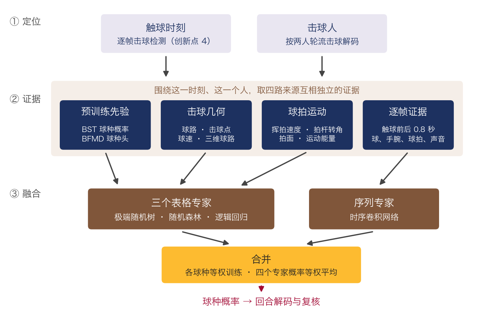

# goodminton

羽毛球单打比赛录像的**击球记录与快速复核**研究原型。

系统先从比赛转播视频自动记下每一拍（击球时刻 + 球种），再把最可能出错的几拍按“改了收益最大”的顺序交给运动员或分析员核对，并在每一拍旁边给出判断用的证据：找拍器是否一致、球拍是否碰到球、有没有击球声、时刻是否记偏。

在 12 场 BFMD 职业单打上逐场留出评测：要把记录纠正到联合 F1 0.80，所需复核时间比现有的逐拍顺序核对少 **82%**，比只看分类器概率的排序少 **72%**；去掉多来源证据、其余不变，要花 2.9 倍的时间；不用触球时刻模型，要花 1.5 倍。

进行中（2026-11-12，尚未并入上面的主评测和工作台，见[进行中的改进](#进行中的改进尚未并入主评测)）：逐帧击球检测模型把找拍 F1 从 0.907 提到 0.970；多视角证据融合的球种模型在找到的击球上判对 85%（推球与挑球合并为一类时 87%）；复核前的全自动联合 F1 估计从 0.755 到 0.81（8 类 0.83）。


## 目录

- [研究问题与技术点](#研究问题与技术点)
- [系统架构](#系统架构)
- [目前结果](#目前结果)
  - [逐帧击球检测（创新点 4）](#逐帧击球检测创新点-4进行中)
  - [以击球为中心的多视角证据融合（创新点 5）](#以击球为中心的多视角证据融合创新点-5进行中)
  - [进行中的改进](#进行中的改进尚未并入主评测)
- [复核工作台：交互逻辑](#复核工作台交互逻辑)
- [运行](#运行)
- [代码结构](#代码结构)
- [本仓库不包含](#本仓库不包含)

## 研究问题与技术点

在原始转播视频上，现有找拍器和球种分类器（TrackNetV3、RacketVision、GRU、ShuttleHitFormer、BST 等）组合起来，联合 F1（击球时刻 ±0.1 s 且球种正确）也只有约 0.7。也就是说，每 10 拍里大约有 3 拍是错的、漏的或球种不对。全部人工重看代价太高，所以这里研究的是：**在有限的复核时间内，怎样让人只看最该看的那几拍，并且一眼看出它为什么可疑。**

1. **问题与基准**：在 BFMD 职业单打 12 场上复现 12 条“球轨迹 × 找拍器”路线和两种 BST 球种分类，量化自动记录的错误构成（误报、漏拍、球种错，以及占漏拍约三分之二的“时刻记偏”），并以“达到同一准确率需要多少复核时间”作为评价指标，按比赛逐场留出。
2. **多来源证据与出错模型（主要技术贡献）**：每一拍汇集互相独立的证据，用来自动核验、估计每种错误的概率并排序，也直接展示给复核者：
   - 12 个找拍器里有几个在这里报了击球，以及它们各自给出的球种是否一致；
   - 球拍接触：击球前后 3 帧内球离拍头的最近距离（RacketVision 球拍关键点，以拍长为单位）；
   - 击球声：10–20 kHz 高频瞬态强度，按每场比赛无标注估计的声画延迟（0.06–0.24 s）对齐；附近更强的击球声提示时刻可能记偏；
   - 三种球种判断的候选（综合判断、BST 原窗口、BST 作者切片规则）、击球前后的球路、两人轮流击球是否被违反；
   - BFMD 专用球种判断：取 BST 分类头前的 600 维特征，在没见过该场比赛的 BFMD 标注上训练的球种头，看它是否同意当前球种。

   出错模型按错误类型（误报、时刻记偏、球种错、漏拍）分别拟合；训练比赛的输入由没见过该场的核验 Agent 交叉拟合产生。交给复核者之前，出错模型先做第二遍自动核验（删去很可能是误报的拍、补上很可能真实的漏拍，被动过的拍沿用这一遍的概率，复核时可以改回）。完整系统达到 F1 0.78 / 0.80 / 0.82 / 0.85 / 0.88 所需的复核时间，比去掉多来源证据、其余不变的同一方法少 77% / 66% / 57% / 44% / 35%（去掉多来源证据后也没有触球时刻模型）。
3. **触球时刻模型**：漏拍里约三分之二其实是时刻记偏，而用击球声、球拍或回合规则去对齐时刻，都不比检测器更准。`benchmarks/bfmd/contact.py` 用 BFMD 参考触球帧训练一个小型时序卷积网络，逐帧读入两路球轨迹、两名球员手腕与球的相对位置、球拍、击球声和各找拍器信号，判断哪一帧是触球。复核前用它把记偏的拍挪到触球帧、把同一次触球的重复记录合并成一拍；复核时它给出建议时刻。达到 F1 0.78–0.88 的复核时间再省 17–42%（0.82 及以上区间不含 0）。轮流击球和节奏仍作为证据进入核验 Agent，工作台在每次纠正后也仍会重新解码回合，但这种“纠正后传播”单独看没有可测增益（±0.3 个点），不作为技术贡献主张。
4. **逐帧击球检测（进行中，尚未并入主评测）**：不再对 12 个找拍器的候选逐个取舍，而是用一个时序卷积网络逐帧读入全部证据（找拍器的投票只是其中一路），直接判断每一帧是不是击球。找拍 F1 0.907 → 0.970，复核前联合 F1 0.755 → 0.784。详见[逐帧击球检测](#逐帧击球检测创新点-4进行中)。
5. **以击球为中心的多视角证据融合（进行中，尚未并入主评测）**：先确定每一拍的触球时刻和击球人，再围绕这一个时刻、这一个人取四路互相独立的证据（预训练分类器的先验、击球几何、球拍运动、逐帧原始信号），交给树模型、逻辑回归和时序卷积网络分别判断，各球种等权训练、概率等权平均。找到的击球里球种判对 82.2% → 85.0%，联合 F1 0.784 → 0.81。详见[以击球为中心的多视角证据融合](#以击球为中心的多视角证据融合创新点-5进行中)。

## 系统架构


| 阶段 | 做什么 | 代码 |
|---|---|---|
| 感知 | 人体姿态（YOLOX / RTMPose）、球轨迹（RacketVision `rv`、TrackNetV3 `tn3`）、球拍关键点 | `benchmarks/bfmd/study_perception.py`、`racketvision_adapter.py`、`specialist_tracknet.py` |
| 找拍 | 6 种找拍器（几何规则、声画融合、GRU、ShuttleHitFormer、Adapted-HitNet、RGB ResNet）× 2 种球轨迹 = 12 条路线，再做击球时刻细化 | `benchmarks/bfmd/study_hits.py`、`refine.py`、`professional_agents/hit_tools.py` |
| 球种 | BST-0 / BST-CG-AP，映射到 BFMD 9 类（高远、挑球、吊球、杀球、平抽、推球、扑球、网前、挡网/防守；发球不计分） | `specialist_bst.py`、`benchmarks/bfmd/bfmd_labels.py` |
| 核验 Agent | 把 12 条路线的候选合并，逐拍判断“保不保留”和“是什么球种”。特征包括找拍器一致性、球路转向与速度、BST 置信度、姿态、球拍接触、击球声 | `benchmarks/bfmd/verify.py`、`audio.py` |
| 复核前自动处理 | 出错模型删去很可能的误报、补上很可能的漏拍；触球时刻模型把记偏的拍挪到触球帧并合并重复记录 | `benchmarks/bfmd/review.py`、`contact.py` |
| 复核 | 排序队列、证据面板、纠正后的合并重复与回合重解码；离线模拟评测 | `benchmarks/bfmd/review.py`、`review_web.py`、`static/review.html` |

上表是主评测和复核工作台使用的流水线。另有三个新模块已写好并在实验脚本里逐场留出验证过，但还没有并入主评测和工作台（`review.py` 里用 `REVIEW_DENSE=1`、`REVIEW_TYPEENS=1` 打开，完整评测尚未跑完）：

| 模块 | 做什么 | 代码 |
|---|---|---|
| 逐帧击球检测 | 时序卷积网络逐帧读入球轨迹、两名球员手腕与球的相对位置、球拍、击球声和 12 个找拍器的投票，直接输出每一帧是击球的概率；取峰值作为自动记录，每个峰值由最近的候选承载并挪到峰值帧 | `benchmarks/bfmd/dense.py` |
| 击球人解码 | 用“谁的手臂离球更近”作证据、“两人轮流击球”作约束，对整个回合解码每一拍是谁打的 | `benchmarks/bfmd/typeens.py`（`hitters`） |
| 多视角证据融合（球种） | 极端随机树 + 随机森林 + 逻辑回归（各类等权）+ 逐帧序列卷积网络，四者概率取平均。输入是原叠加球种特征、BFMD 球种头、触球帧的球路与击球人姿态、击球点相对身体的位置、击球前后的球速与转向、三维球路 | `benchmarks/bfmd/typeens.py` |
| 三维球路 | 用球场四角标定摄像机（焦距由球场平面单应求出），在重力和羽毛球空气阻力下把两拍之间的球路拟合成三维轨迹，起止点锚在击球人和接球人的场地位置；同一回合相邻两拍共用击球点，连起来再拟合一遍。输出出手球速、仰角、击球高度、过网高度、落点 | `benchmarks/bfmd/flight3d.py` |

评测时，每场比赛的回合只由在另外 11 场上拟合的核验 Agent 和出错模型处理；复核工作台使用同样冻结的逐场模型包 `frozen_review_lomo12.json`（含每场只在另外 11 场上训练的触球时刻模型）。

## 目前结果

数据：BFMD 职业单打 12 场、131 个回合（约 1300 次非发球击球）。主结果为 **12 场比赛逐场留出**：每场比赛只由在另外 11 场上拟合的模型处理，置信区间按比赛自助抽样 1000 次。

### 复核效率

用 BFMD 参考答案模拟一个复核者：每看一项就按真值修正（删误报、改球种、把记偏的击球挪到正确时刻、补漏拍）。复核成本为假设值：核对一拍 5 秒、挪动时刻另加 3 秒、核对一个漏拍候选 6 秒（需在用户实验中实测）。横轴是“复核用时占逐拍全查用时的比例”。


| 联合 F1 / 复核比例 | 0 | 10% | 20% | 30% | 50% |
|---|---:|---:|---:|---:|---:|
| 现有做法：无多来源证据，按时间顺序逐拍核对 | 0.689 | 0.714 | 0.750 | 0.768 | 0.806 |
| 最强单一来源基线：无多来源证据，按分类器概率排序 | 0.689 | 0.729 | 0.764 | 0.800 | 0.863 |
| 同一方法去掉多来源证据（出错模型 + 第二遍自动核验） | 0.694 | 0.740 | 0.778 | 0.819 | 0.876 |
| 完整系统，不用触球时刻模型（不能挪时刻） | 0.743 | 0.788 | 0.822 | 0.856 | 0.891 |
| **完整系统（多来源证据 + 出错模型 + 触球时刻模型）** | **0.755** | **0.808** | **0.841** | **0.872** | **0.908** |
| 理想顺序（上限，同一起点） | 0.755 | 0.836 | 0.915 | 0.961 | 0.970 |

达到同一联合 F1 所需复核时间，完整系统节省：


| 完整系统对比 | 达到 F1 0.78 | 0.80 | 0.82 | 0.85 | 0.88 |
|---|---:|---:|---:|---:|---:|
| 现有做法（无多来源证据，逐拍顺序核对） | 87% [77, 100] | 82% [72, 94] | 77% [66, 86] | 68% [60, 78] | 59% [50, 68] |
| 最强单一来源基线（无多来源证据，按分类器概率） | 81% [65, 100] | 72% [56, 91] | 63% [46, 77] | 49% [37, 65] | 44% [33, 54] |
| 同一方法去掉多来源证据（创新点 2 消融） | 77% [59, 100] | 66% [49, 88] | 57% [41, 71] | 44% [32, 58] | 35% [24, 45] |
| 不用触球时刻模型、不能挪时刻（创新点 3 消融） | 42% [−33, 100] | 35% [0, 55] | 33% [5, 47] | 18% [6, 33] | 17% [4, 29] |

方括号为 95% 区间（上限截到 100%）。节省来自几部分：多来源证据和出错模型的第二遍自动核验让自动记录本身更准（复核前 0.689 → 0.743），触球时刻模型挪时刻、合并重复后到 0.755；出错模型让前 30% 的复核更集中在真错误上。以上结果都用 2026-11-10 起的球种模型设置（见“球种识别”）。

没有触球时刻模型时，“挪动时刻”这个操作单独看：在 50% 以内的复核量上只省 1–5% 的时间（区间包含 0），时刻证据用于排序也没有增益；它的作用在复核后期，全部复核完时剩余漏拍从 103 个减到 76 个（联合 F1 0.950 → 0.962）。有了触球时刻模型，挪时刻在复核前就自动完成，见下节。

### 触球时刻模型（创新点 3）

`benchmarks/bfmd/contact.py` 用 BFMD 参考触球帧训练一个小型时序卷积网络：输入击球前后每一帧的两路球轨迹、两名球员手腕与球的距离、球拍、击球声和各找拍器信号，判断哪一帧是触球。12 场逐场留出：精确命中触球帧 59%（原检测器 7%），时刻记偏的拍纠对 86%。复核前用它把记偏的拍挪到正确的帧，并把同一次触球的重复记录合并为一拍（复核后附近的重复也随之合并）：

| 联合 F1 / 复核比例 | 0 | 10% | 20% | 30% | 50% |
|---|---:|---:|---:|---:|---:|
| 完整系统（无触球模型，不能挪时刻） | 0.743 | 0.788 | 0.822 | 0.856 | 0.891 |
| **+ 触球时刻模型 + 合并重复 + 挪时刻** | **0.755** | **0.808** | **0.841** | **0.872** | **0.908** |

达到 F1 0.78 / 0.80 / 0.82 / 0.85 / 0.88 的复核时间再省 42% / 35% / 33% / 18% / 17%（0.82 及以上区间不含 0；上面的总表和图已包含这一项）。之前的上限实验（用参考答案把重复记录和记偏的拍全部自动纠正）在旧的球种设置下复核前 F1 为 0.760，比当时不用触球模型的 0.729 高 0.031，触球模型拿到了其中约三分之一。逐场看，12 场中 7 场复核前 F1 提高、5 场略降（最多 −0.03）：两拍真触球相隔不到 0.3 秒的快速对抽里，模型偶尔会把一拍挪到邻居的触球帧上再被合并。限制“不能越过邻居”反而让总体变差（击球 F1 0.908 → 0.903），所以保留现在的做法。

### 逐帧击球检测（创新点 4，进行中）

**要解决的问题。** 原流水线的自动记录是“先让 12 个找拍器各自报出候选，再逐个决定保留还是丢掉”。在 1125 个带球种的参考击球里它漏了 145 个，逐个对照后：

| 漏拍原因 | 拍数 | 原方法能否补救 |
|---|---|---|
| 记了，但时刻偏 0.1–0.4 s | 46 | 只能靠触球时刻模型事后挪 |
| 有候选，被保留模型丢掉 | 76 | 靠出错模型第二遍补回一部分 |
| 12 个找拍器都没报 | 23 | 不能 |

三种漏拍的共同原因是：决定“这里有没有击球”的模型只能看到已经成形的候选，看不到候选之间的那些帧。

**方法。** `benchmarks/bfmd/dense.py` 把找拍改成逐帧的序列标注：

- **输入**：回合的每一帧一个 22 维向量（与触球时刻模型共用，`contact.frame_features`）：TrackNetV3 球的位置、速度、速度变化、转向和检测置信度；RacketVision 球与 TrackNetV3 球的距离；近端、远端球员各自“手腕到球的距离（以身高为单位）、球相对头的高度、球相对身体的左右位置”；球到拍头的距离；按声画延迟对齐后的高频击球声强度；**12 个找拍器里有几个在这一帧报了击球**。
- **网络**：6 层一维卷积（64 通道、卷积核 5、空洞率 1 / 2 / 4 / 8 / 16 / 1，ReLU，dropout 0.2），最后一层 1×1 卷积给出每帧一个分数。感受野约前后各 2 秒，能看到一拍的来球、触球和回球。
- **训练目标**：每个参考击球帧（含发球）周围放一个标准差 1.2 帧的高斯峰，其余帧为 0；带正类权重 3 的二元交叉熵；AdamW，50 轮，3 个随机种子取平均。只用训练比赛的标注。
- **输出记录**：取概率不低于 0.5 的局部峰值，峰值之间至少间隔 0.2 s。每个峰值由 0.3 s 内最近的候选承载并挪到峰值帧，没有峰值的候选从记录里移出。球种分类、证据和复核仍沿用候选上的原有信息。

**和原有模块的区别。**

| | 看到的范围 | 能做什么 |
|---|---|---|
| 核验 Agent 的保留模型 | 单个候选的特征 | 保留或丢掉一个已有候选 |
| 触球时刻模型（创新点 3） | 一个已记录的拍前后 0.3 s | 在这 0.3 s 内挑最像触球的一帧，不能增加拍 |
| 逐帧击球检测 | 整个回合的每一帧 | 直接给出每一拍及其时刻 |

12 个找拍器从“候选的唯一来源”变成网络的一路输入：它们都报的地方网络会更有把握，它们都没报但球路转向、手腕贴近、有击球声的地方网络也能报出来；峰值本身就是触球时刻。

**结果（12 场逐场留出，实验脚本）。**

| | 原流水线 | 逐帧击球检测 |
|---|---|---|
| 带球种的参考击球里找对的 | 980 / 1125 | 1065 / 1125 |
| 漏拍 | 145 | 60 |
| 找拍 F1（±0.1 s） | 0.907 | 0.970 |
| 复核前联合 F1（球种模型不变） | 0.755 | 0.784 |

- 网络峰值直接对参考击球打分（不经候选）：找对 1090、误报 38、漏 35；阈值在 0.4–0.6 之间 F1 为 0.967–0.968，对阈值不敏感。
- 各场比赛找拍 F1 在 0.90–0.99 之间（只有 10 拍的一场是 0.83）。
- 剩下的 60 个漏拍里，约 30 个是网络概率不到 0.5；另有 21 个网络报了峰值，但 0.3 s 内没有候选可以承载而被丢掉。给这些峰值新建候选估计只再加约 0.004 的联合 F1，没有做。

**局限。** 需要逐帧的击球标注来训练；阈值 0.5 是事先固定的，没有在留出比赛上调；并入主评测后，复核排序和出错模型要在新的记录上重新拟合，正式数字尚未跑出。

### 以击球为中心的多视角证据融合（创新点 5，进行中）

**要解决的问题。** 原球种模型是一个带 L2 正则的线性 Softmax，输入是 BST 两种分类器的概率、击球后的球路和前后拍的 BST 概率。它有三个限制：证据是按检测器给的窗口算的，而不是按真正的触球时刻和击球人；线性模型表达不了“击球点高而且球速快才是杀球”这类组合条件；训练数据里网前 314 拍、挑球 241 拍而推球只有 50 拍，数量少的球种被数量多的吞掉——标注为推球的 50 拍只认出 14 拍。

**结构。** 先确定每一拍“什么时候打的、谁打的”，再围绕这一个时刻、这一个人从四个互相独立的来源取证据，交给几类错法不同的模型分别判断，最后等权合并。



**① 定位。** 触球时刻来自逐帧击球检测（创新点 4）。击球人以“谁的手臂离球更近”为证据、“两人轮流击球”为约束对整个回合解码：原来按“谁的脚离球的地面投影近”判断，相邻两拍只有 12% 被判成不同的人，解码后是 99%。后面所有证据都以这一帧、这个人为参照。

**② 证据。** 四路证据来源不同，一路出错时其他几路不受影响：

| 证据 | 内容 | 来源 |
|---|---|---|
| 预训练先验 | BST-0 与 BST-CG-AP 的球种概率、按相邻击球重新切窗后的重判、BFMD 球种头、前后拍的球种概率和间隔 | 在 ShuttleSet 上预训练的分类器 |
| 击球几何 | 触球帧重算的球路、击球点相对头和髋的高度与前后、击球前后的球速与转向、三维球路的出手球速、仰角、过网高度和落点 | 球轨迹、骨架、球场标定 |
| 球拍运动 | 击球人球拍在触球前后各 0.33 s 的挥动：拍头速度、挥动弧长、拍杆转过的角度、拍杆在画面里的长度、拍面宽度；持拍手一侧画面的帧间变化强度 | 球拍关键点、视频帧差 |
| 逐帧证据 | 触球前后各 0.8 s，每帧的球、两名球员手腕与球的相对位置、球拍、击球声 | 原始逐帧信号，不经过 BST |

**③ 融合。** 前三路证据是每拍一行的表格，交给三个表格专家；第四路是时间序列，交给序列专家。

| 专家 | 输入 | 作用 |
|---|---|---|
| 极端随机树（500 棵 × 3 个种子） | 表格证据 | 学证据之间的组合条件 |
| 随机森林（500 棵 × 3 个种子） | 表格证据 | 与上一个错法不同，平均后更稳 |
| 逻辑回归（标准化，C = 0.1） | 表格证据 | 保留线性模型的平滑判断 |
| 时序卷积网络（3 层、48 通道、空洞率 1 / 2 / 4，3 个种子） | 逐帧证据 | 直接读挥拍和球路随时间的变化 |

- **各球种等权训练**：表格专家按类别频率的倒数加权，使每个球种对损失的贡献相同。
- **概率等权平均**：四个专家的 9 类概率直接取平均。它没有需要拟合的参数，在只有约一千拍标注时不会过拟合，也不需要为训练组合模型再做一重嵌套的逐场留出。实验里在其上再叠一层（用相邻拍的预测、在易混的两类之间重判）都没有更好。
- **序列专家的训练**：用训练比赛的参考触球帧，每帧取前后 ±2 帧抖动的 5 个窗口，使它对检测时刻的小偏差不敏感。

**三条设计原则。** 先定位、再取证；证据来源互相独立；专家异质、合并不需要学习。

**结果（12 场逐场留出，逐帧检测找到的 1065 拍，9 类）。**

| 配置 | 球种判对 | 复核前联合 F1 |
|---|---|---|
| 原线性叠加模型 | 82.2% | 0.784 |
| 本结构，不含球拍运动证据 | 84.0% | 0.80 |
| 本结构，含球拍关键点 | 84.7% | 0.81 |
| 本结构，含球拍关键点和帧差运动强度 | **85.0%** | **0.81** |

- 各专家单独：时序卷积网络 79.9%，逻辑回归 83.0–83.6%，随机森林 83.9–84.2%，极端随机树 84.1–84.8%。
- 各球种等权的作用：推球找回率 28% → 50%，挑球 96% → 93%。
- 加入球拍运动后，变好的是杀球（90% → 92%）、挡网 / 防守（76% → 78%）、高远（75% → 77%）；推球反而从 54% 降到 46%。
- 球拍在触球前后只有 56% 的帧能被检测到，而且挥得越快越看不到，这限制了球拍证据的作用。

**需要如实说明的地方。**

- 总共提高 2.8 个点，是整个结构累计的结果。逐项去掉来看，只有“异质专家 + 各球种等权”和“球拍运动”各自带来了可见的变化；击球人解码、三维球路单独去掉时数字基本不变。应当把它作为一个整体来主张，而不是声称每个部件都有效。
- 1065 拍上的统计误差约 ±1.1 个点，球拍证据带来的 1 个点还在这个范围内。
- 球拍运动证据的提取在 `benchmarks/bfmd/racket.py`，85.0% 来自实验脚本；它还没有接入 `typeens.py` 的特征表，`typeens.py` 当前对应的是 84.0% 那一行。
- 继续加证据不再有提升，原因见下面“进行中的改进”里的上限检查。

### 球种识别

找到的击球里，球种判对约 84%（复核前，12 场留出）。各类别（旧设置下，974 个找对的击球）：网前 94%、挑球 91%、杀球 89%、高远 77%、挡网 / 防守 72%、吊球 69%、推球 44%、平抽 42%。最常见的混淆是平抽 ↔ 挡网 / 防守 / 挑球 / 网前、推球 ↔ 网前 / 挑球、吊球 ↔ 杀球。

2026-11-10 把叠加球种模型（BST 两种分类器概率、BST 作者窗口重判、击球后球路、前后拍）的 L2 正则从 3 调到 10（`VERIFY_TYPE_L2`）：在同一批找对的击球上，球种正确率 82.3% → 83.7%；整条流水线复核前联合 F1 0.740 → 0.755（12 场中 6 场提高、3 场略降、3 场不变），多判对 18 拍。BFMD 球种头仍只作为出错证据：放进球种模型在离线数据上到 84.3%，但整条流水线里复核前 F1 只有 0.750，不如只作证据的 0.755。

试过但没有提升的（都是 12 场留出）：
- 用 BFMD 标注微调 BST-CG-AP 本身（11 场的参考触球 + 记录击球，换成 9 类输出头）：单独用 79.7%，低于现有 82.3%；和现有模型按对数概率加权组合也没有增益。
- 把 BST 的 600 维特征直接接进球种模型：正则再强也只有 77–80%。
- 小型神经网络（MLP）代替线性模型、加入击球者姿态（手腕相对头和肩的高度、手臂伸展）或前后拍间隔：83–84.5%，和线性模型持平。
- 在训练比赛上按准确率调各类别的偏置：82.8%，更差。

### 进行中的改进（尚未并入主评测）

以下数字来自实验脚本，同样是 12 场逐场留出，但只算到“复核前的自动记录”，没有重跑复核模拟和各对比方法；并入流水线后的正式数字可能略有出入。

| | 找拍 F1 | 找到的击球里球种判对 | 复核前联合 F1 |
|---|---|---|---|
| 主评测的流水线 | 0.907 | 82.7% | 0.755 |
| + 逐帧击球检测 | 0.970 | 82.2% | 0.784 |
| + 多视角证据融合，不含球拍运动（9 类） | 0.970 | 84.0% | 0.80 |
| + 球拍运动证据（9 类） | 0.970 | 85.0% | 0.81 |
| 同上，推球与挑球合并为“推挑”（8 类） | 0.970 | 86.7% | 0.83 |

提升来自哪里（逐步累加，复核前联合 F1）：

| 方法 | 提升的环节 | 联合 F1 | 增量 |
|---|---|---|---|
| 主评测的流水线 | — | 0.755 | — |
| 逐帧击球检测代替候选取舍 | 找拍 F1 0.907 → 0.970 | 0.784 | +0.029 |
| 以击球为中心的多视角证据融合 | 球种 82.2% → 85.0% | 0.81 | +0.025 |

把推球和挑球合并为一类是换了一种分类方式，不是方法上的改进；在这种分法下球种判对 86.7%、联合 F1 0.83，单独列出，不计入上表。

- **找拍**：1125 个带球种的参考击球里找对的从 980 个增加到 1065 个，漏拍从 145 个降到 60 个。原流水线的 145 个漏拍里，46 个是记了但偏 0.1–0.4 s，76 个是有候选但被丢掉，23 个没有候选。检测阈值固定为 0.5（0.4–0.6 之间找拍 F1 基本不变）。
- **击球人**：原来用“谁的脚离球的地面投影近”判断击球人，相邻两拍只有 12% 被判成不同的人；按轮流击球解码后是 99%。
- **各类别（8 类，不含球拍运动证据时）**：网前 93%、推挑 91%、杀球 90%、挡网 / 防守 81%、高远 75%、吊球 64%、平抽 / 抽球 63%、扑球 56%。剩余错误主要是吊球 ↔ 杀球、推挑 → 网前、网前 ↔ 挡网 / 防守、抽球 → 挡网 / 防守。
- **三维球路**：97% 的击球能拟合；出手球速中位数为杀球 231–270 km/h、吊球 134–153、高远 131–147、推球 79–83、挑球 76、挡网 / 防守 52–58、网前 35–40。按落点区分杀球和吊球的能力很弱（AUC 0.53–0.57），纵深方向的误差约 1 m。
- **只报有把握的球**：按模型把握排序，保留最有把握的 90% / 85% / 80% 时，球种判对 91% / 93% / 94%。

**球种正确率为什么停在 84–86%。** 下面每一项单独加进去都没有带来可测的提升（都落在 83–85%，9 类）：

- 击球点相对头、髋的高度与前后，来球高度，上一拍的飞行和下一拍的接球位置；
- 击球前后的平均球速、转向角、速度比、加速度，以及只用真实检测点对转向前后两段飞行做二次拟合得到的出手与到达速度；
- 三维球路的全部物理量（单独用 72%），回合连起来拟合后的版本，以及只在杀球 / 吊球等易混对之间用物理量重判；
- 按解码出的击球人只保留 BST 25 类中该方的类别，多个时间窗取平均，或直接使用 25 类原始概率；
- 对留出比赛做无标注自适应（自训练、按场归一化）；
- VideoMAE（Kinetics-400 预训练，不微调）在击球人周围 16 帧画面上的特征：单独用 62%。

几项上限检查指向同一个原因——这套标注在边界模糊的球种上本身不一致：

| 检查 | 结果 |
|---|---|
| 训练时见过同一场比赛的其他回合 | 84.6%，与逐场留出的 84.4% 相同 |
| 训练比赛从 8 场加到 11 场 | 85.8% → 85.6%（8 类），不再上升 |
| 把前后两拍的真实球种直接作为输入（上限） | 87.0%（8 类） |
| 一位懂球的人不看标注和模型，盲判 59 拍（一致与不一致各抽 30 拍，按比例加权） | 与原标注一致 83%（95% 区间 75–91%），与模型一致 86%（78–95%） |

盲判只有一位判断者、59 拍，区间很宽，只能说明模型与标注的一致程度已经和人与标注的一致程度相当，还不能作为结论。

### 自动记录与证据


单独抽取的 36 个新回合上（Agent 冻结后才抽样），复核前联合 F1：固定流水线 0.689 → 核验 Agent 0.694 → + 球拍接触 0.703 → + 击球声 0.709。


在 12 场留出中，专门的出错模型对各类错误的区分度（AUC，只用置信度 → 用全部证据，未含球种头）：误报 0.829 → 0.886，时刻记偏 0.801 → 0.811，球种错 0.838 → 0.842，漏拍候选 0.775 → 0.790。

### 试过但没有用的方法

- 纠正后传播（相邻击球的可疑度、重解码回合、重算轮流击球）：12 场留出中相对不传播 ±0.3 个点。
- 回合结构化解码（相邻触球至少 0.3 s、两人轮流击球，复核后重新解码）+ 挪动时刻：相对都不用，达到 F1 0.78–0.88 省 5–12% 时间，区间包含 0。上限实验（用参考答案把重复记录和记偏的拍全部自动纠正）可省 44–67%（F1 0.78–0.82），说明空间存在；瓶颈是 30 fps 下单独用某一种证据（击球声、球拍、球路转向、各路线时刻）定位真正触球帧并不比检测器更准。用这些证据在每拍窗口内做线性打分的触球帧定位器、加入回合几何的球种模型也都没有带来可测的提升；改用逐帧读入全部证据的时序卷积网络后才有效（见“触球时刻模型”）。
- 按回合规律传播球种（学到的球种转换先验）：相邻标签变对和变错大约各半。
- 按错误类型校准、按场在线调整出错概率：都不如未校准的收益排序。
- 同场比赛用已核对击球微调分类器或相似击球投票：剩余击球的球种准确率没有实质提升。
- 自动把击球时刻对齐到击球声 / 球拍峰值：改对和改错相当；只作为给复核者的提示。
- 把 BFMD 球种头直接加进球种模型：复核前 F1 反而 0.721 → 0.717；只作为出错证据时才有用。
- 让复核者只报每回合总拍数再重选击球、在“同一人连击”的空档里找漏拍：几乎没有作用。
- 加训练数据（3 → 11 场）：复核前 F1 提高，但出错信号的区分度不再提高。
- 用确认的击球重估声画延迟、每场比赛的击球声纹、只靠声音补出漏拍：都不如直接用击球声强度，或误报太多。

## 复核工作台：交互逻辑

地址：`http://127.0.0.1:8765/review`。页面分成四块：顶部状态、左侧视频与证据时间轴、右上“先看这几拍”队列、右下当前这拍的证据和操作。

### 1. 选回合

右上角下拉框按比赛列出全部 131 个回合，显示赛事、对阵、时长和已核对数。每个回合都由没见过这场比赛的冻结模型处理，所以研究模式下的对比是公平的。也可以直接用链接打开：`/review?clip=<回合 ID>`。打开后自动选中队列第一项，视频跳到这一拍前 1.2 秒播放到后 0.8 秒，画面先显示击球那一帧。

### 2. 顶部状态

| 数字 | 含义 |
|---|---|
| 已核对 | 本回合已做的操作数 |
| 估计用时 | 按每拍 5 秒、每个漏拍候选 6 秒、挪动时刻另加 3 秒估算 |
| 预计剩余错误（拍） | 未核对击球的 P(误报) + P(球种错) 与未核对漏拍候选的 P(确实漏了) 之和 |
| 记录中的击球 | 当前记录里的击球数；下方小字为复核前自动处理的结果：第二遍自动核验删去 / 补上的拍数，以及按触球时刻模型挪动了时刻的拍数 |
| 研究模式（勾选后显示） | 与 BFMD 参考答案对比的联合 F1，只用于研究演示，正常复核时不显示 |

### 3. 证据时间轴（视频下方）


- 最上一排是系统记下的击球：绿色 = 可信，橙 / 红 = 可疑（颜色按出错概率），虚线圈 = 可能漏掉的击球，深绿带 ✓ = 已核对保留，灰色 ✕ = 已删除或已排除。选中的那一拍画得更大。
- 下面 12 行是 12 条找拍路线各自报的击球时刻（RV / TNv3 × 声画、GRU、HitNet、RGB、规则、SHF）。很多行在某处都有点而上排没有，就是可能漏拍；上排有点而下面几乎没有，就是可能误报。
- 红色竖线跟着视频播放位置移动。点上排任意圆点即可跳到那一拍。

### 4. “先看这几拍”队列

按“改了它对联合 F1 的预期收益 ÷ 核对它要花的秒数”排序：

- 各类错误的概率来自出错模型：它读取这一拍的全部证据（找拍器一致性、球拍、击球声、时刻证据、球种候选是否一致、轮流击球、节奏），按错误类型分别给出 P(误报)、P(时刻记偏)、P(球种错 | 是击球)、P(漏拍是真的)；
- 预期收益 = P(时刻记偏) × 2 + [P(误报) − P(时刻记偏)] × 0.7 + [1 − P(误报)] × P(球种错) × 2，漏拍候选为 P(漏拍是真的) × 1.3（由 F1 公式推得的近似权重）；秒数为 5（漏拍候选 6），可能需要挪时刻的按概率另加 3；
- 出错几率还会乘上邻居纠正带来的可疑度（邻居错过 ×约 1.6，邻居对 ×约 0.9）。

每项旁边的标签是预期收益最大的那类错误：“时刻可能记偏”、“可能不是击球”、“球种可能判错”、“可能漏了一拍”，或“可能被误删”（第二遍自动核验删掉、但仍有一定可能是真击球的拍，时间轴上显示为虚线圈）。

### 5. 证据面板（当前这拍）

从上到下：

1. **标题**：时刻、第几拍、当前判定的球种、近端还是远端球员、可疑原因。
2. **概率条**：记录中的击球显示“不是击球的可能”、其中“时刻记偏”的部分和“球种判错的可能”；漏拍候选显示“确实有一拍的可能”。
3. **多少个找拍器同意这里有一拍**：12 个标签，绿色表示该路线在 ±窗口内报了击球。
4. **球拍有没有碰到球、有没有击球声**：球离拍头最近多少个拍长（<0.5 很近，<1.5 较近，否则较远），以及这一刻高频瞬态是本回合平常水平的几倍（≥4 很明显，≥2 有一些）。对已按触球模型挪动的拍，这两项按挪动后的时刻显示。如果触球时刻模型认为真正的触球在别的帧（差 2 帧以上、但把握不够自动挪），会提示“触球时刻模型认为触球更可能在 X s（概率 P%）”，并给一个“跳到那一刻”按钮。
5. **和相邻一拍是不是同一个人打的**：同一人连击的概率；≥60% 时提示附近很可能有误报或漏拍。
6. **球种候选**：综合判断、BST 原窗口、BST 按作者规则三列，各列前三名及概率。
7. **击球前后的球路**：蓝线为击球前，绿线为击球后，红点为判定的击球时刻；下方显示上一拍和下一拍的球种与时间差。

### 6. 操作和它们的效果

| 对象 | 操作 | 快捷键 | 效果 |
|---|---|---|---|
| 记录中的击球 | 判断正确 ✓ | Enter | 锁定这拍和它的球种 |
| 记录中的击球 | 不是击球 | X | 从记录中删除并锁定 |
| 记录中的击球 | 点某个球种按钮 | — | 改成该球种并锁定 |
| 记录中的击球 | 时刻不对：挪到当前画面 | T | 把这拍挪到视频当前时刻（先用空格重播、暂停在触球那一帧，或用“跳到那一刻”），之后仍可点球种按钮改球种 |
| 漏拍候选 | 点某个球种按钮（“确实漏了，球种是：”） | — | 加入记录并锁定 |
| 漏拍候选 | 没有漏拍 | X | 排除并锁定 |
| 任意 | 重播这一拍 | 空格 | 从击球前 1.2 秒播到后 0.8 秒 |

每次操作后服务器依次：

1. 先检查操作是否适用于这一项（不适用的不会被保存），再锁定；如果这次操作说明系统原来错了（删除、补拍、挪时刻、改成不同球种），把前后相邻击球的出错几率乘约 1.6，否则乘约 0.9；
2. 重新解码整个回合：已锁定的击球作为固定值，其余击球的球种按前后文和球种转换先验重算（删掉或补上一拍会改变相邻击球的上下文）；
3. 重算每一拍的轮流击球违反度、预计剩余错误和队列；
4. 如果这一拍留在记录里，同一次触球附近（0.3 秒内）未核对的重复记录并入它；
5. 自动跳到新的队列第一项并播放（挪动时刻后则停在这一拍，方便接着改球种）。

打开这个回合时，复核前的自动处理已经删去 2 拍（3.0 s、5.7 s，两拍都是误报），并按触球时刻模型挪动了 9 拍，其中把两个原本记偏的击球挪对（6.43 → 6.63 s，新时刻的击球声是平常的 94 倍；2.37 → 2.47 s）。研究模式下的联合 F1 在核对前就从 0.600 变成 0.889。下图是按队列前 6 项操作后的状态：确认 3 拍、确认 2 个被自动删去的拍确实不是击球、把 7.07 s 改成挑球，估计 32 秒，联合 F1 到 1.0。


### 7. 保存与重置

- 每个回合的核对记录保存为操作列表（`pipeline_study/review_sessions/<回合>.json`，含时间戳）。重新打开页面时按顺序重放这些操作，所以状态总是可复现的；服务重启后也能接着核对。
- “重新开始”清空该回合的操作记录。
- 修改记录的请求需要页面里的会话令牌，并且只接受本机访问。

## 运行

依赖见 `requirements-vision.lock.txt`（网站和复核）、`requirements-pose.lock.txt`（姿态）、`requirements-specialist.lock.txt`（找拍与 BST）。

```bash
cd 04_原型
.venv-vision/bin/python server.py          # http://127.0.0.1:8765，复核页面为 /review
```

复核页面需要 BFMD 研究数据已经跑好（`03_数据/独立基准/BFMD/pipeline_study/` 下的 `clips.json`、各回合的 `perception/`、`routes_v3/` 和逐场模型包 `frozen_review_lomo12.json`）。从头生成：

```bash
python benchmarks/bfmd/rally_clips.py --cut               # 按比赛拆分开发 / 测试，抽取回合并切片（--new-test 抽新回合）
python benchmarks/bfmd/study_perception.py --role dev     # 姿态、两种球轨迹、球拍关键点
BFMD_VARIANT=v3 python benchmarks/bfmd/study_hits.py --role dev --expensive   # 12 条找拍路线 + BST 球种（各角色都跑）
python -m benchmarks.bfmd.verify evaluate                 # 核验 Agent，开发集留一场比赛
python -m benchmarks.bfmd.verify freeze                   # 用全部开发集拟合并冻结
python -m benchmarks.bfmd.verify apply --role new_test    # 冻结 Agent 处理新回合
python benchmarks/bfmd/study_score.py --role new_test     # 唯一读取 BFMD 标注的评分步骤
REVIEW_CONTACT=1 REVIEW_TYPEHEAD=2 python -m benchmarks.bfmd.review lomo  # 触球时刻模型的评测（每折训练一次）
REVIEW_TYPEHEAD=2 python -m benchmarks.bfmd.review lomo  # 12 场逐场留出：复核模拟，含 BFMD 球种头证据（REVIEW_ABLATE=sources 去掉多来源证据；REVIEW_RETIME=0 只能删除不能挪时刻）
python -m benchmarks.bfmd.review_metrics "auto pass + evidence" --run typehead2 --base-run ablate_sources   # 节省时间与自助法区间
REVIEW_TYPEHEAD=2 python -m benchmarks.bfmd.review freeze  # 冻结工作台用的逐场模型包（含球种头和第二遍自动核验阈值）
REVIEW_TYPEHEAD=2 python -m benchmarks.bfmd.review freeze-contact  # 给每个模型包加上只在其 11 场训练比赛上训练的触球时刻模型
```

## 代码结构

| 位置 | 内容 |
|---|---|
| 根目录 `*.py` | 核心模块：网站与任务（`server.py`、`*_jobs.py`）、感知、找拍、BST 分类、标注与个人学习、研究集成 |
| `benchmarks/bfmd/` | BFMD 导入、回合切片、找拍与球种实验、核验 Agent、声音证据、复核模拟与复核工作台后端 |
| `static/` | 网页前端（`review.html` 为复核工作台） |
| `professional_agents/` | 早期的四 Agent 编排（感知、击球理解、技术战术、示范检索）和工具注册 |
| `paper_reproductions/` | ShuttleHitFormer、DSTA 本地复现与配置 |
| `research_models/` | 模型登记、架构与融合设置 |
| `scripts/` | 审计、诊断、评价、作者流程复现、数据准备、报告生成 |
| `tests/` | 单元与集成测试 |
| `docs/images/` | README 中的截图和结果图 |

`scripts/` 和 `tests/` 中的文件会自动把原型根目录加入 `sys.path`，可以从任意目录运行。

### `benchmarks/bfmd/` 文件

| 文件 | 作用 |
|---|---|
| `rally_clips.py` | 按比赛拆分（开发 8 场 / 测试），固定种子抽取回合（含新回合抽样）并切片 |
| `study_perception.py` | 对每个回合运行姿态、两种球轨迹和球拍模型 |
| `study_hits.py`、`refine.py` | 运行每个找拍器并细化击球时刻，再用 BST 分类 |
| `bfmd_labels.py` | BST 球种到 BFMD 9 类的映射 |
| `verify.py` | 核验 Agent：候选合并、特征、保留模型与球种模型、冻结与应用 |
| `contact.py` | 触球时刻模型：逐帧证据与时序卷积网络 |
| `dense.py` | 逐帧击球检测模型（实验中）：训练、取峰值、把自动记录换成峰值 |
| `typeens.py` | 多视角证据融合的球种模型（实验中）：击球人解码、每拍的表格特征与逐帧窗口、树模型 + 逻辑回归 + 序列网络 |
| `flight3d.py` | 三维球路（实验中）：摄像机标定、带阻力的飞行模拟与拟合、回合连起来拟合、物理量特征 |
| `racket.py` | 球拍运动证据（实验中，尚未接入 `typeens.py`）：击球人球拍的挥动特征、持拍手一侧的帧差运动强度 |
| `audio.py` | 高频谱通量、按场声画延迟估计、击球声强度（`verify.timing_evidence` 用它找附近更强的击球声） |
| `review.py` | 回合重解码、证据出错模型（交叉拟合）、复核排序与模拟、12 场逐场留出评测、工作台模型包 |
| `review_metrics.py` | 达到同一准确率所需复核时间的节省，按比赛自助法区间 |
| `review_web.py` | 复核工作台后端：会话重放、操作、证据、队列 |
| `study_score.py`、`evaluate.py` | 评分（只有这一步读取 BFMD 标注；策略冻结前拒绝评测试集） |
| `study_select.py` | 早期的流水线选择策略比较 |

## 本仓库不包含

- 模型权重（`models/`）和第三方代码（`vendor/`）：请按各上游仓库的许可证自行获取。
- 视频、标注和实验数据：个人录像不公开；BFMD 视频请按 [BFMD](https://github.com/Ning-D/BFMD) 说明自行下载。README 中的截图来自 BFMD 转播回合。
- Python 环境：依赖见 `requirements-*.lock.txt`。

部分配置和代码中的路径仍是原开发机的绝对路径，迁移时需要调整。
